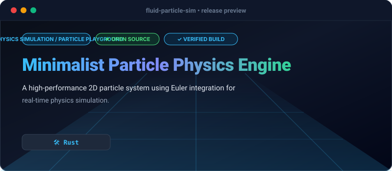

# Minimalist Particle Physics Engine

[](https://github.com/Olamideakinade/fluid-particle-sim)
[](https://opensource.org/licenses/MIT)



A performant, dependency-minimal 2D particle simulation engine written in Rust. It utilizes basic Newtonian mechanics to simulate particle movement within a bounded box.

## Key Capabilities
- Euler integration for position updates.
- Boundary collision detection (rebound logic).
- Configurable particle counts and simulation bounds.

## Quickstart
```bash
git clone https://github.com/user/fluid-particle-sim
cd fluid-particle-sim
cargo run
```

## Architecture
The engine separates the `Simulation` state from individual `Particle` entities. The core loop performs constant-time updates, making it suitable for integration into real-time rendering pipelines.

## License
MIT